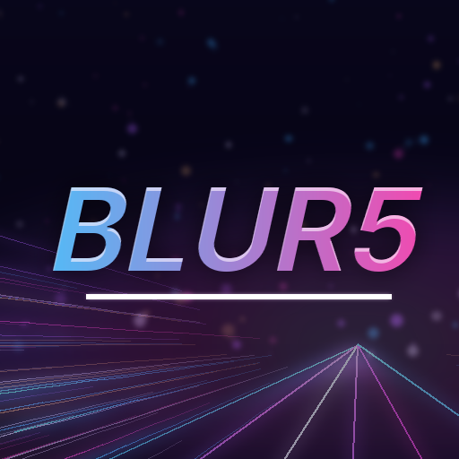

<p align="center">
  
</p>

<h1 align="center">Blur5</h1>

<p align="center">
  Play the PC game <strong>Blur</strong> (Bizarre Creations, 2010)
  on a jailbroken PlayStation 5, using your own copy of the game.
</p>

<p align="center">
  <a href="https://www.buymeacoffee.com/bornaradusin">
    
  </a>
</p>

---

Blur5 lets you play the PC game *Blur* (Bizarre Creations, 2010) on a jailbroken PS5, using
your own copy of the game. It gets its own tile on the PS5 Home screen, called **Blur5**
(title ID `PPSA11016`).

It runs the PC version of the game with [prospero-win](https://github.com/mpereiraesaa/prospero-win),
which brings Wine (a way to run Windows programs) and DXVK (a graphics layer) to the PS5.

**You need your own copy of the game. This project does not include it.** The repo and the app
hold only code, settings, patches and pictures of our own, plus open-source projects built from
their source code. Nothing in them comes from the game. The mods the game uses are downloaded by the PS5 when you install, and each one is checked
against a fixed fingerprint (SHA-256). Blur5 is not connected to Activision, Bizarre Creations
or Sony.

## What it does

- Installs Blur from your copy. Your copy is never changed.
- Leaves out any mods that are already in your copy (`dsound.dll`, `scripts/`, `amax/`, …) and
  adds its own:
  - **Ultimate ASI Loader** (by ThirteenAG), which lets the other mods load
  - **Online play through Amax** (on by default): multiplayer goes to the
    [Amax](https://amax-emu.com) community servers
  - **Amax extras** (off by default): Amax's own add-on, with profile pictures and extra
    plugins
- Starts the game straight from its tile. **Hold Square while the tile starts** to open Blur5's
  own page instead. On that page you can pick the picture size (3840×2160, 2560×1440 or
  1920×1080), turn on a speed counter, turn the two options above on or off, repair the game
  (Triangle) and play.
- In the game, the touchpad moves the mouse pointer, and pressing it clicks. To quit, hold
  Options and the touchpad together for about a second.
- The controller rumbles when the game asks for it, and L2 and R2 vibrate too. You can turn
  the trigger part down or off in the PS5 settings (Accessibility or Accessories, Controllers,
  trigger effect intensity).
- The game plays in your PS5's language when your copy has that language. An English copy has
  English, French and Italian (its language file, `english.txt`, lists them). If your copy
  doesn't have the PS5's language, the game stays as it is.
- Blur5's own page is in English.

## What you need

- A PS5 that runs homebrew, with an FTP server, an ELF loader (elfldr on local port 9021) and
  [ShadowMount+](https://github.com/drakmor/ShadowMountPlus), which adds apps from
  `/data/homebrew` to the Home screen. Made on firmware 13.60 with kstuff-lite, ShadowMount+
  and Payload Manager.
- **Your Blur folder**, from Blur installed on a PC. Note: the game's original exe, from the
  disc or the old Steam release, has SecuROM copy protection, which does not work with Wine.
  A copy like that installs, then closes as soon as it starts, and Blur5's page tells you so
  the next time you open it. Blur5 does not remove or get around SecuROM, and does not point
  to anything that does.

## Putting it on the PS5

1. Download `PPSA11016.zip` from this repo's Releases page and unzip it. Copy the
   `PPSA11016` folder to `/data/homebrew/PPSA11016` on the PS5 over FTP. ShadowMount+ adds the
   Blur5 tile. Restart the PS5 if the tile doesn't appear.
2. Open Blur5 once. It makes these folders:

   | Folder | What goes in it |
   | --- | --- |
   | `/data/Blur5/base` | your game files |
   | `/data/Blur5/save` | a save to start from (optional) |
   | `/data/Blur5/app` | Blur5's own files: settings, logs and the downloaded mods |

3. Copy everything inside your Blur folder (the folder with `Blur.exe` in it) into
   `/data/Blur5/base` over FTP. Or put your Blur folder on a USB drive, named `Blur`: Blur5
   copies it into `/data/Blur5/base` as part of the install.
4. To start from a save you already have (your own, or a finished one), put Blur's `blursave`
   file in `/data/Blur5/save` **before** you install. A fresh install puts it where Blur keeps
   its save. Once Blur has a save of its own, the install never replaces it.
5. Open Blur5 and press Install. It downloads the mods (about 4 MB, or 7 MB with the Amax
   extras), copies your game and adds the mods.

After that, the tile starts the game.

The installed game itself lives in `/data/prospero-win/prefixes/blur5`. That folder belongs
to prospero-win, which other prospero-win games share, so it stays where prospero-win expects
it.

## Building it yourself

One script builds everything inside a fixed Docker container (Ubuntu 24.04), from the files in
this repo. The same commit always gives the same files.

```sh
git clone https://github.com/bornaradusin/Blur5
cd Blur5 && tools/build.sh
```

The six open-source projects Blur5 is built from are not stored in this repo. The build
downloads each one at the fixed version listed in `tools/linked-projects.txt`.

You need a 64-bit x86 Linux computer with Docker. The app and its zip end up in
`release/PPSA11016/` and `release/PPSA11016.zip`, with their fingerprints in
`release/SHA256SUMS`. You can run single steps, for example `tools/build.sh game-app audit`.
The `audit` step stops the build if the repo or the app holds a Windows program that wasn't
built from source here, or game data.

Checks you can run on the computer, without a PS5:

- `python3 -m pytest tests`: the install plan, the copy check, the pictures and the audit.
- `cd launcher && bash tools/store-test.sh`: the app's own tests.
- `tools/host-install.sh`: runs the app's installer against a copy of your Blur folder
  (`BLUR=…`). Your folder is only read, never changed.
- `tools/host-run.sh 120`: starts that install with the computer's own Wine and the DXVK the
  build made. `HEADLESS=1920x1080` runs it without a screen.

## What is where

| Path | What |
| --- | --- |
| `tools/` | the build (`build.sh`), and the scripts it uses: prospero-win, DXVK, the graphics library, the empty Wine setup, the bundle, the app's `SOURCES.txt` and `THIRD_PARTY.md` (`make-notices.py`), the app zip, the audit and the computer checks |
| `patches/` | changes to prospero-win, PS5_Mesa, PS5_Vulkan and DXVK, taken from nfs-blackbox-ps5 |
| `launcher/` | the app itself (`eboot.bin`): the copy check, the install and the settings page. Based on nfs-blackbox-launcher. |
| `profile/blur/` | how Blur is installed: the plan maker, the config files, and the sizes and fingerprints of the game's known files (numbers only) |
| `art/` | the pictures: `make-art.py` draws the tile, the Home screen background and the page background from scratch (nothing from the game) |
| `sce_sys/param.json` | a copy of the app's `param.json` (the build writes it), so the title ID and version can be read from the repo |
| `tools/linked-projects.txt` | the six projects the build downloads (prospero-win, PS5_Mesa, PS5_Vulkan, PS5_PayloadSDK, ps5-native-app-boilerplate and ps5-opengl), each at a fixed version |

## Credits

- Blur5 is a modified version of [Sahin](https://github.com/7tg/sahin) by Barbaros Gören
  (7tg), used under the GPL-3.0.
- [prospero-win](https://github.com/mpereiraesaa/prospero-win), PS5_Mesa, PS5_Vulkan and the
  [ps5-opengl](https://github.com/mpereiraesaa/ps5-opengl) fork by mpereiraesaa; ps5-opengl,
  the native app boilerplate and the app's look, first made by BlackBearReloaded; the PS5
  Payload SDK.
- [nfs-blackbox-ps5](https://github.com/lavavex/nfs-blackbox-ps5) and
  [nfs-blackbox-launcher](https://github.com/lavavex/nfs-blackbox-launcher) by lavavex, whose
  tools, patches and launcher this is built from.
- Wine, Mesa, DXVK and LLVM, which everything runs on.
- The mods, each downloaded from its own page: the
  [Ultimate ASI Loader](https://github.com/ThirteenAG/Ultimate-ASI-Loader) (ThirteenAG),
  [amax-redirect](https://github.com/Aib0t/amax-dns-asi) (Aib0t) and the Amax add-on (the Amax
  team).
- *Blur* is Activision's. Blur5 is not connected to Activision, Bizarre Creations or Sony.

## License

GPL-3.0 (`LICENSE`). The patches in `patches/` follow the licences of the projects they change,
and the six linked projects keep their own. In the app folder, `THIRD_PARTY.md` says what each part
is and which licence it uses, with the full texts in `LICENSES/`, and `SOURCES.txt` names the
exact source of each part: this repo at the commit the app was built from, the app, DXVK, and
prospero-win's own records of Wine, Mesa and the rest.
